# Poly Haven: Streets & Town HDRIs

**111 assets from [Poly Haven](https://polyhaven.com), dedicated to the public domain under [CC0](https://polyhaven.com/license).** Use them in any game, free or paid, and change them however you like; no credit is needed.

HDRI skies and environments as 1K and 2K Radiance `.hdr` images, for lighting and backgrounds. 893.7 MB in all.

This is a copy kept by [zuujis-cc0](https://github.com/zuujis-cc0) so game makers can take single files from GitHub. It is not made by or affiliated with Poly Haven: the originals, often in more formats and higher resolutions, are on [polyhaven.com](https://polyhaven.com). If they help you, consider [supporting Poly Haven](https://www.patreon.com/polyhaven/overview).

Every file is listed in [MANIFEST.tsv](MANIFEST.tsv) with its size and SHA-256. More free assets: [the Zuujis collection](https://github.com/zuujis-cc0/free-game-assets#readme).

| | | | |
| :-: | :-: | :-: | :-: |
| <a href="abandoned_parking">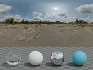</a> <b><a href="abandoned_parking">Abandoned Parking</a></b> by Sergej Majboroda · <a href="https://polyhaven.com/a/abandoned_parking">source</a> | <a href="adams_place_bridge">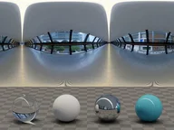</a> <b><a href="adams_place_bridge">Adams Place Bridge</a></b> by Andreas Mischok · <a href="https://polyhaven.com/a/adams_place_bridge">source</a> | <a href="afrikaans_church_exterior">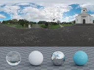</a> <b><a href="afrikaans_church_exterior">Afrikaans Church Exterior</a></b> by Dimitrios Savva, Jarod Guest · <a href="https://polyhaven.com/a/afrikaans_church_exterior">source</a> | <a href="amphitheatre_zanzibar_fort">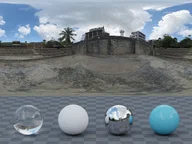</a> <b><a href="amphitheatre_zanzibar_fort">Amphitheatre Zanzibar Fort</a></b> by Dimitrios Savva, Jarod Guest · <a href="https://polyhaven.com/a/amphitheatre_zanzibar_fort">source</a> |
| <a href="autumn_road">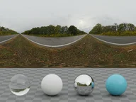</a> <b><a href="autumn_road">Autumn Road</a></b> by Sergej Majboroda · <a href="https://polyhaven.com/a/autumn_road">source</a> | <a href="beach_cloudy_bridge">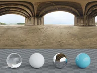</a> <b><a href="beach_cloudy_bridge">Beach Cloudy Bridge</a></b> by Dimitrios Savva, Jarod Guest · <a href="https://polyhaven.com/a/beach_cloudy_bridge">source</a> | <a href="beach_parking">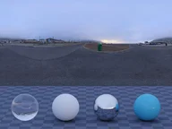</a> <b><a href="beach_parking">Beach Parking</a></b> by Greg Zaal, Rico Cilliers · <a href="https://polyhaven.com/a/beach_parking">source</a> | <a href="belvedere">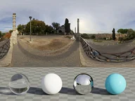</a> <b><a href="belvedere">Belvedere</a></b> by Greg Zaal, Rico Cilliers · <a href="https://polyhaven.com/a/belvedere">source</a> |
| <a href="bethnal_green_entrance">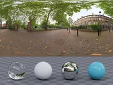</a> <b><a href="bethnal_green_entrance">Bethnal Green Entrance</a></b> by Andreas Mischok · <a href="https://polyhaven.com/a/bethnal_green_entrance">source</a> | <a href="between_bridges">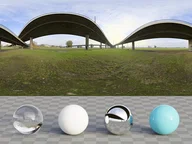</a> <b><a href="between_bridges">Between Bridges</a></b> by Greg Zaal · <a href="https://polyhaven.com/a/between_bridges">source</a> | <a href="birbeck_street_underpass">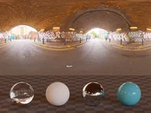</a> <b><a href="birbeck_street_underpass">Birbeck Street Underpass</a></b> by Andreas Mischok · <a href="https://polyhaven.com/a/birbeck_street_underpass">source</a> | <a href="blaubeuren_church_square">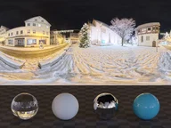</a> <b><a href="blaubeuren_church_square">Blaubeuren Church Square</a></b> by Andreas Mischok · <a href="https://polyhaven.com/a/blaubeuren_church_square">source</a> |
| <a href="bloem_olive_house">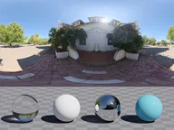</a> <b><a href="bloem_olive_house">Bloem Olive House</a></b> by Greg Zaal, Jenelle van Heerden · <a href="https://polyhaven.com/a/bloem_olive_house">source</a> | <a href="braustuble_alley">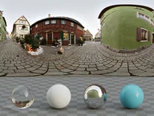</a> <b><a href="braustuble_alley">Braustuble Alley</a></b> by Elvis Posa · <a href="https://polyhaven.com/a/braustuble_alley">source</a> | <a href="cambridge">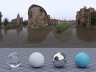</a> <b><a href="cambridge">Cambridge</a></b> by Andreas Mischok · <a href="https://polyhaven.com/a/cambridge">source</a> | <a href="canary_wharf">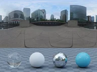</a> <b><a href="canary_wharf">Canary Wharf</a></b> by Andreas Mischok · <a href="https://polyhaven.com/a/canary_wharf">source</a> |
| <a href="castel_st_angelo_roof">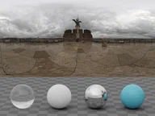</a> <b><a href="castel_st_angelo_roof">Castel St. Angelo Roof</a></b> by Andreas Mischok · <a href="https://polyhaven.com/a/castel_st_angelo_roof">source</a> | <a href="cedar_bridge">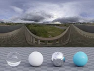</a> <b><a href="cedar_bridge">Cedar Bridge</a></b> by Greg Zaal · <a href="https://polyhaven.com/a/cedar_bridge">source</a> | <a href="cedar_bridge_2">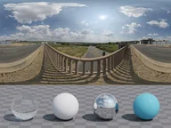</a> <b><a href="cedar_bridge_2">Cedar Bridge 2</a></b> by Dario Barresi · <a href="https://polyhaven.com/a/cedar_bridge_2">source</a> | <a href="cedar_bridge_sunset_1">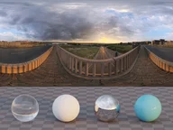</a> <b><a href="cedar_bridge_sunset_1">Cedar Bridge Sunset 1</a></b> by Dario Barresi · <a href="https://polyhaven.com/a/cedar_bridge_sunset_1">source</a> |
| <a href="cedar_bridge_sunset_2">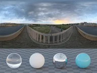</a> <b><a href="cedar_bridge_sunset_2">Cedar Bridge Sunset 2</a></b> by Dario Barresi · <a href="https://polyhaven.com/a/cedar_bridge_sunset_2">source</a> | <a href="chapmans_drive">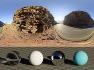</a> <b><a href="chapmans_drive">Chapman's Drive</a></b> by Greg Zaal, Rico Cilliers · <a href="https://polyhaven.com/a/chapmans_drive">source</a> | <a href="circus_maximus_1">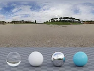</a> <b><a href="circus_maximus_1">Circus Maximus 1</a></b> by Greg Zaal, Rico Cilliers · <a href="https://polyhaven.com/a/circus_maximus_1">source</a> | <a href="circus_maximus_2">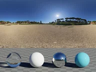</a> <b><a href="circus_maximus_2">Circus Maximus 2</a></b> by Greg Zaal, Rico Cilliers · <a href="https://polyhaven.com/a/circus_maximus_2">source</a> |
| <a href="cobblestone_parish_road">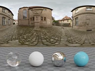</a> <b><a href="cobblestone_parish_road">Cobblestone Parish Road</a></b> by Elvis Posa · <a href="https://polyhaven.com/a/cobblestone_parish_road">source</a> | <a href="cobblestone_street_night">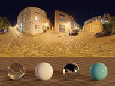</a> <b><a href="cobblestone_street_night">Cobblestone Street Night</a></b> by Greg Zaal, Jenelle van Heerden · <a href="https://polyhaven.com/a/cobblestone_street_night">source</a> | <a href="colosseum">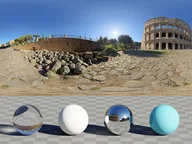</a> <b><a href="colosseum">Colosseum</a></b> by Greg Zaal, Rico Cilliers · <a href="https://polyhaven.com/a/colosseum">source</a> | <a href="concrete_tunnel">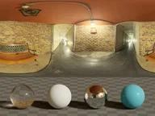</a> <b><a href="concrete_tunnel">Concrete Tunnel</a></b> by Greg Zaal · <a href="https://polyhaven.com/a/concrete_tunnel">source</a> |
| <a href="concrete_tunnel_02">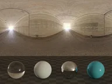</a> <b><a href="concrete_tunnel_02">Concrete Tunnel 02</a></b> by Andreas Mischok · <a href="https://polyhaven.com/a/concrete_tunnel_02">source</a> | <a href="courtyard">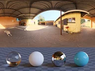</a> <b><a href="courtyard">Courtyard</a></b> by Greg Zaal · <a href="https://polyhaven.com/a/courtyard">source</a> | <a href="courtyard_night">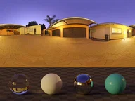</a> <b><a href="courtyard_night">Courtyard Night</a></b> by Greg Zaal · <a href="https://polyhaven.com/a/courtyard_night">source</a> | <a href="crosswalk">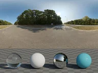</a> <b><a href="crosswalk">Crosswalk</a></b> by Sergej Majboroda · <a href="https://polyhaven.com/a/crosswalk">source</a> |
| <a href="dam_bridge">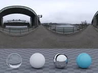</a> <b><a href="dam_bridge">Dam Bridge</a></b> by Adrian Kubasa · <a href="https://polyhaven.com/a/dam_bridge">source</a> | <a href="derelict_highway_midday">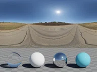</a> <b><a href="derelict_highway_midday">Derelict Highway Midday</a></b> by Dimitrios Savva, Jarod Guest · <a href="https://polyhaven.com/a/derelict_highway_midday">source</a> | <a href="derelict_highway_noon">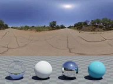</a> <b><a href="derelict_highway_noon">Derelict Highway Noon</a></b> by Greg Zaal · <a href="https://polyhaven.com/a/derelict_highway_noon">source</a> | <a href="derelict_overpass">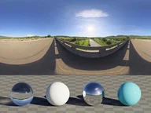</a> <b><a href="derelict_overpass">Derelict Overpass</a></b> by Greg Zaal · <a href="https://polyhaven.com/a/derelict_overpass">source</a> |
| <a href="derelict_underpass">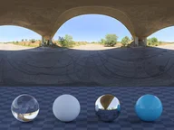</a> <b><a href="derelict_underpass">Derelict Underpass</a></b> by Greg Zaal · <a href="https://polyhaven.com/a/derelict_underpass">source</a> | <a href="dirt_bike_track_01">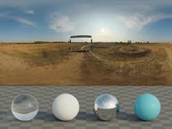</a> <b><a href="dirt_bike_track_01">Dirt Bike Track 01</a></b> by Sergej Majboroda · <a href="https://polyhaven.com/a/dirt_bike_track_01">source</a> | <a href="dresden_square">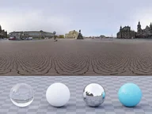</a> <b><a href="dresden_square">Dresden Square</a></b> by Greg Zaal · <a href="https://polyhaven.com/a/dresden_square">source</a> | <a href="driving_school">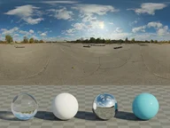</a> <b><a href="driving_school">Driving School</a></b> by Sergej Majboroda · <a href="https://polyhaven.com/a/driving_school">source</a> |
| <a href="dusseldorf_bridge">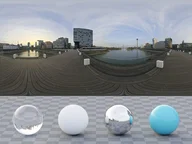</a> <b><a href="dusseldorf_bridge">Dusseldorf Bridge</a></b> by Greg Zaal · <a href="https://polyhaven.com/a/dusseldorf_bridge">source</a> | <a href="evening_museum_courtyard">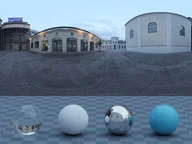</a> <b><a href="evening_museum_courtyard">Evening Museum Courtyard</a></b> by Grzegorz Wronkowski · <a href="https://polyhaven.com/a/evening_museum_courtyard">source</a> | <a href="georgentor">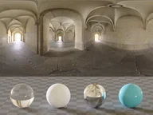</a> <b><a href="georgentor">Georgentor</a></b> by Greg Zaal · <a href="https://polyhaven.com/a/georgentor">source</a> | <a href="german_town_street">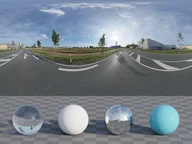</a> <b><a href="german_town_street">German Town Street</a></b> by Alexander Scholten · <a href="https://polyhaven.com/a/german_town_street">source</a> |
| <a href="glass_passage">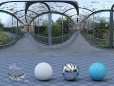</a> <b><a href="glass_passage">Glass Passage</a></b> by Greg Zaal · <a href="https://polyhaven.com/a/glass_passage">source</a> | <a href="glencairn_expressway">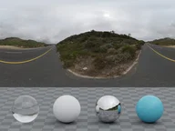</a> <b><a href="glencairn_expressway">Glencairn Expressway</a></b> by Greg Zaal · <a href="https://polyhaven.com/a/glencairn_expressway">source</a> | <a href="hamburg_canal">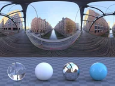</a> <b><a href="hamburg_canal">Hamburg Canal</a></b> by Greg Zaal · <a href="https://polyhaven.com/a/hamburg_canal">source</a> | <a href="hansaplatz">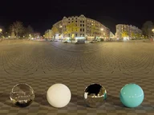</a> <b><a href="hansaplatz">Hansaplatz</a></b> by Greg Zaal · <a href="https://polyhaven.com/a/hansaplatz">source</a> |
| <a href="highway_bridge_sunset">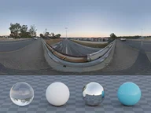</a> <b><a href="highway_bridge_sunset">Highway Bridge Sunset</a></b> by Dario Barresi, Jenelle van Heerden · <a href="https://polyhaven.com/a/highway_bridge_sunset">source</a> | <a href="homecoming_center_rooftop">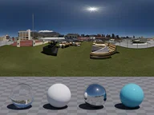</a> <b><a href="homecoming_center_rooftop">Homecoming Center Rooftop</a></b> by Dario Barresi · <a href="https://polyhaven.com/a/homecoming_center_rooftop">source</a> |  <b><a href="hotel_rooftop_balcony">Hotel Rooftop Balcony</a></b> by Dimitrios Savva, Jarod Guest · <a href="https://polyhaven.com/a/hotel_rooftop_balcony">source</a> |  <b><a href="illovo_beach_balcony">Illovo Beach Balcony</a></b> by Greg Zaal · <a href="https://polyhaven.com/a/illovo_beach_balcony">source</a> |
|  <b><a href="irish_institute">Irish Institute</a></b> by Savva Zakharov · <a href="https://polyhaven.com/a/irish_institute">source</a> |  <b><a href="konigsallee">Konigsallee</a></b> by Greg Zaal · <a href="https://polyhaven.com/a/konigsallee">source</a> |  <b><a href="konzerthaus">Konzerthaus</a></b> by Greg Zaal · <a href="https://polyhaven.com/a/konzerthaus">source</a> |  <b><a href="laufenurg_church">Laufenurg Church</a></b> by Adrian Kubasa · <a href="https://polyhaven.com/a/laufenurg_church">source</a> |
|  <b><a href="learner_park">Learner Park</a></b> by Greg Zaal · <a href="https://polyhaven.com/a/learner_park">source</a> |  <b><a href="leibstadt">Leibstadt</a></b> by Adrian Kubasa · <a href="https://polyhaven.com/a/leibstadt">source</a> |  <b><a href="little_paris_eiffel_tower">Little Paris Eiffel Tower</a></b> by Dimitrios Savva, Jarod Guest · <a href="https://polyhaven.com/a/little_paris_eiffel_tower">source</a> |  <b><a href="lot_02">Lot 02</a></b> by Philip Modin · <a href="https://polyhaven.com/a/lot_02">source</a> |
|  <b><a href="mall_parking_lot">Mall Parking Lot</a></b> by Sergej Majboroda · <a href="https://polyhaven.com/a/mall_parking_lot">source</a> |  <b><a href="medieval_cafe">Medieval Cafe</a></b> by Dimitrios Savva, Jarod Guest · <a href="https://polyhaven.com/a/medieval_cafe">source</a> |  <b><a href="modern_buildings_2">Modern Buildings 2</a></b> by Alexander Scholten · <a href="https://polyhaven.com/a/modern_buildings_2">source</a> |  <b><a href="modern_buildings_night">Modern Buildings Night</a></b> by Greg Zaal · <a href="https://polyhaven.com/a/modern_buildings_night">source</a> |
|  <b><a href="modern_evening_street">Modern Evening Street</a></b> by Grzegorz Wronkowski · <a href="https://polyhaven.com/a/modern_evening_street">source</a> |  <b><a href="mosaic_tunnel">Mosaic Tunnel</a></b> by Greg Zaal, Rico Cilliers · <a href="https://polyhaven.com/a/mosaic_tunnel">source</a> |  <b><a href="museum_of_history">Museum of History</a></b> by Oliksiy Yakovlyev · <a href="https://polyhaven.com/a/museum_of_history">source</a> |  <b><a href="narrow_moonlit_road">Narrow Moonlit Road</a></b> by Greg Zaal · <a href="https://polyhaven.com/a/narrow_moonlit_road">source</a> |
|  <b><a href="neuer_zollhof">Neuer Zollhof</a></b> by Greg Zaal · <a href="https://polyhaven.com/a/neuer_zollhof">source</a> |  <b><a href="night_bridge">Night Bridge</a></b> by Sergej Majboroda · <a href="https://polyhaven.com/a/night_bridge">source</a> |  <b><a href="nowhere_road">Nowhere Road</a></b> by Dario Barresi, Jarod Guest · <a href="https://polyhaven.com/a/nowhere_road">source</a> |  <b><a href="nqweba_bridge">Nqweba Bridge</a></b> by Dario Barresi · <a href="https://polyhaven.com/a/nqweba_bridge">source</a> |
|  <b><a href="old_outdoor_theater">Old Outdoor Theater</a></b> by Sergej Majboroda · <a href="https://polyhaven.com/a/old_outdoor_theater">source</a> |  <b><a href="outdoor_umbrellas">Outdoor Umbrellas</a></b> by Sergej Majboroda · <a href="https://polyhaven.com/a/outdoor_umbrellas">source</a> |  <b><a href="overcast_industrial_courtyard">Overcast Industrial Courtyard</a></b> by Grzegorz Wronkowski · <a href="https://polyhaven.com/a/overcast_industrial_courtyard">source</a> |  <b><a href="ox_bridge_morning">Ox Bridge Morning</a></b> by Dimitrios Savva, Jarod Guest · <a href="https://polyhaven.com/a/ox_bridge_morning">source</a> |
|  <b><a href="palermo_sidewalk">Palermo Sidewalk</a></b> by Andreas Mischok · <a href="https://polyhaven.com/a/palermo_sidewalk">source</a> |  <b><a href="palermo_square">Palermo Square</a></b> by Andreas Mischok · <a href="https://polyhaven.com/a/palermo_square">source</a> |  <b><a href="park_parking">Park Parking</a></b> by Andreas Mischok · <a href="https://polyhaven.com/a/park_parking">source</a> |  <b><a href="parking_garage">Parking Garage</a></b> by Greg Zaal, Rico Cilliers · <a href="https://polyhaven.com/a/parking_garage">source</a> |
|  <b><a href="pedestrian_overpass">Pedestrian Overpass</a></b> by Greg Zaal · <a href="https://polyhaven.com/a/pedestrian_overpass">source</a> |  <b><a href="pergola_walkway">Pergola Walkway</a></b> by Dario Barresi · <a href="https://polyhaven.com/a/pergola_walkway">source</a> |  <b><a href="piazza_bologni">Piazza Bologni</a></b> by Andreas Mischok · <a href="https://polyhaven.com/a/piazza_bologni">source</a> |  <b><a href="piazza_san_marco">Piazza San Marco</a></b> by Greg Zaal, Rico Cilliers · <a href="https://polyhaven.com/a/piazza_san_marco">source</a> |
|  <b><a href="plac_wolnosci">Plac Wolnosci</a></b> by Grzegorz Wronkowski · <a href="https://polyhaven.com/a/plac_wolnosci">source</a> |  <b><a href="portland_landing_pad">Portland Landing pad</a></b> by Philip Modin · <a href="https://polyhaven.com/a/portland_landing_pad">source</a> |  <b><a href="potsdamer_platz">Potsdamer Platz</a></b> by Greg Zaal · <a href="https://polyhaven.com/a/potsdamer_platz">source</a> |  <b><a href="pretville_street">Pretville Street</a></b> by Dimitrios Savva, Jarod Guest · <a href="https://polyhaven.com/a/pretville_street">source</a> |
|  <b><a href="quadrangle_cloudy">Quadrangle Cloudy</a></b> by Savva Zakharov · <a href="https://polyhaven.com/a/quadrangle_cloudy">source</a> |  <b><a href="quadrangle_sunny">Quadrangle Sunny</a></b> by Savva Zakharov · <a href="https://polyhaven.com/a/quadrangle_sunny">source</a> |  <b><a href="quattro_canti">Quattro Canti</a></b> by Andreas Mischok · <a href="https://polyhaven.com/a/quattro_canti">source</a> |  <b><a href="railway_bridges">Railway Bridges</a></b> by Sergej Majboroda · <a href="https://polyhaven.com/a/railway_bridges">source</a> |
|  <b><a href="rathaus">Rathaus</a></b> by Greg Zaal · <a href="https://polyhaven.com/a/rathaus">source</a> |  <b><a href="red_church">Red Church</a></b> by Grzegorz Wronkowski · <a href="https://polyhaven.com/a/red_church">source</a> |  <b><a href="red_hill_cloudy">Red Hill Cloudy</a></b> by Greg Zaal · <a href="https://polyhaven.com/a/red_hill_cloudy">source</a> |  <b><a href="red_hill_curve">Red Hill Curve</a></b> by Greg Zaal, Rico Cilliers · <a href="https://polyhaven.com/a/red_hill_curve">source</a> |
|  <b><a href="red_hill_straight">Red Hill Straight</a></b> by Greg Zaal, Rico Cilliers · <a href="https://polyhaven.com/a/red_hill_straight">source</a> |  <b><a href="red_wall">Red Wall</a></b> by Greg Zaal, Rico Cilliers · <a href="https://polyhaven.com/a/red_wall">source</a> |  <b><a href="rooftop_day">Rooftop Day</a></b> by Greg Zaal · <a href="https://polyhaven.com/a/rooftop_day">source</a> |  <b><a href="rooftop_night">Rooftop Night</a></b> by Greg Zaal · <a href="https://polyhaven.com/a/rooftop_night">source</a> |
|  <b><a href="rotes_rathaus">Rotes Rathaus</a></b> by Alexander Scholten · <a href="https://polyhaven.com/a/rotes_rathaus">source</a> |  <b><a href="round_platform">Round Platform</a></b> by Sergej Majboroda · <a href="https://polyhaven.com/a/round_platform">source</a> |  <b><a href="san_giuseppe_bridge">San Giuseppe Bridge</a></b> by Greg Zaal, Rico Cilliers · <a href="https://polyhaven.com/a/san_giuseppe_bridge">source</a> |  <b><a href="schadowplatz">Schadowplatz</a></b> by Greg Zaal · <a href="https://polyhaven.com/a/schadowplatz">source</a> |
|  <b><a href="short_tunnel">Short Tunnel</a></b> by Greg Zaal · <a href="https://polyhaven.com/a/short_tunnel">source</a> |  <b><a href="simons_town_road">Simon's Town Road</a></b> by Greg Zaal · <a href="https://polyhaven.com/a/simons_town_road">source</a> |  <b><a href="skidpan">Skidpan</a></b> by Dimitrios Savva, Jarod Guest · <a href="https://polyhaven.com/a/skidpan">source</a> |  <b><a href="skylit_garage">Skylit Garage</a></b> by Greg Zaal, Rico Cilliers · <a href="https://polyhaven.com/a/skylit_garage">source</a> |
|  <b><a href="small_cathedral_02">Small Cathedral 02</a></b> by Sergej Majboroda · <a href="https://polyhaven.com/a/small_cathedral_02">source</a> |  <b><a href="small_rural_road">Small Rural Road</a></b> by Andreas Mischok · <a href="https://polyhaven.com/a/small_rural_road">source</a> |  <b><a href="st_peters_square_night">St. Peters Square Night</a></b> by Andreas Mischok · <a href="https://polyhaven.com/a/st_peters_square_night">source</a> |  |

---

Kept up to date by this repository's own [update workflow](.github/workflows/update.yml), with code and plan from [cc0-mirror](https://github.com/zuujis-cc0/cc0-mirror). Something wrong? [Open an issue there](https://github.com/zuujis-cc0/cc0-mirror/issues/new) or use the [private report form](https://games.zuujis.com/report).
